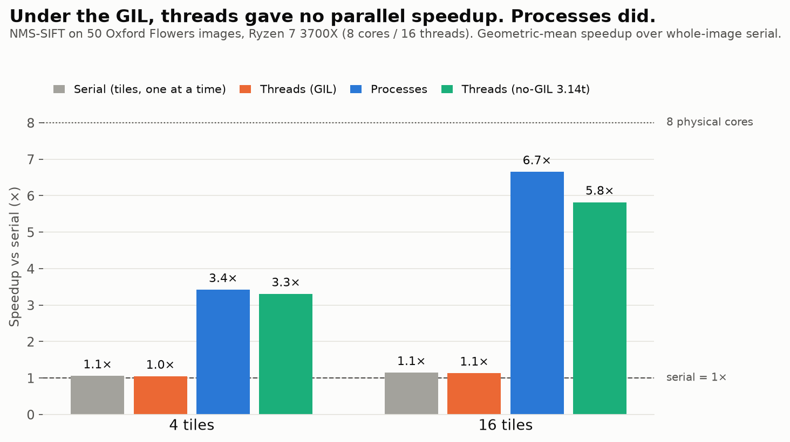
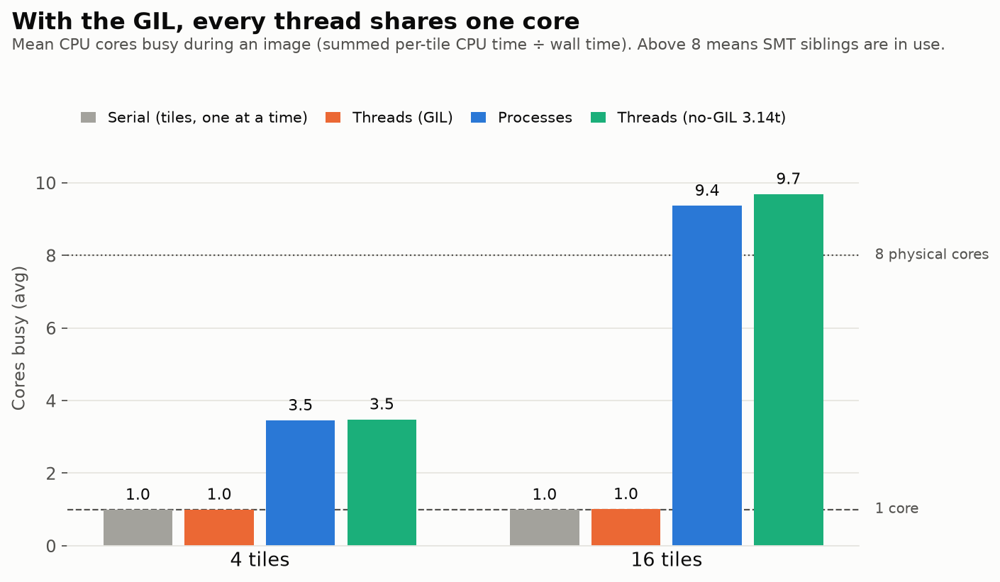
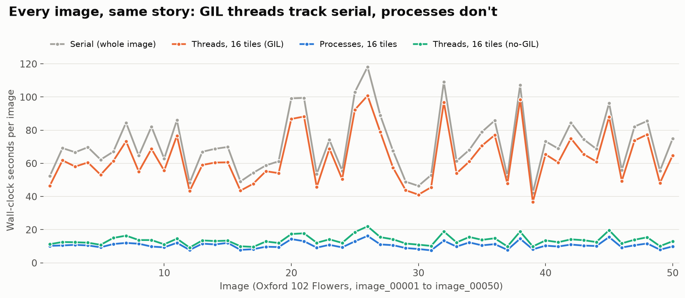
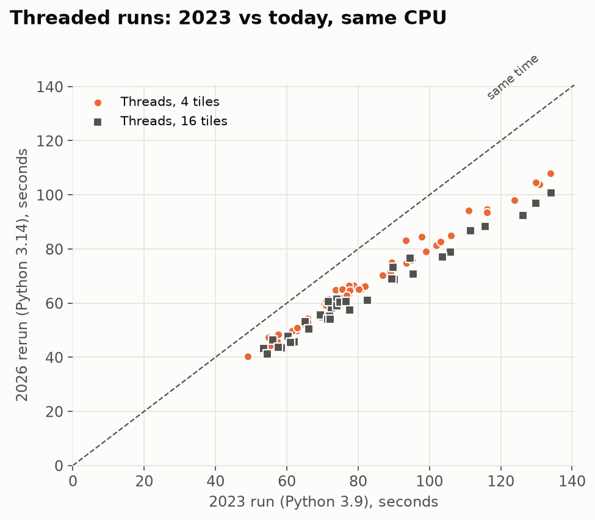

# Parallel NMS-SIFT: why more threads didn't help, and what did

Senior undergraduate research project in parallel processing for content-based image retrieval (CBIR),
rebuilt and re-run end to end.



## TL;DR

**Hypothesis (2023):** splitting each image into 16 tiles, one thread per tile, would extract SIFT features
faster than 4 tiles.

**Result (2023):** a null result. There was no significant improvement: 16 tiles were faster on only 24 of 36
images, by about 1.4% on average, and neither setup was meaningfully faster than plain serial code. Worse,
splitting the image cost accuracy: 16 tiles found 5% fewer keypoints than 4 tiles, because keypoints near
tile borders are lost.

**Diagnosis:** the SIFT implementation is pure Python, and CPython's **Global Interpreter Lock** lets only one
thread run Python bytecode at a time. The threads were taking turns on one core. Measured directly, threaded
runs kept **1.0 core** busy on an 8-core CPU.

**Fix:** use processes instead of threads, so each tile gets its own interpreter and its own core.

Rerun on the same 50 images and the same CPU (AMD Ryzen 7 3700X, 8 cores / 16 threads). Speedup is the
geometric mean over 50 images, relative to whole-image serial on the same interpreter:

| Method | 4 tiles | 16 tiles | Cores busy (16 tiles) |
|---|---|---|---|
| Serial, tiles one at a time (control) | 1.05× | 1.14× | 1.0 |
| Threads, GIL (the 2023 method) | 1.04× | 1.13× | 1.0 |
| **Processes** | **3.42×** | **6.65×** | 9.4 |
| Threads, free-threaded Python 3.14t (no GIL) | 3.30× | 5.82× | 9.7 |

Two takeaways:
- **The small edge 16 tiles had in 2023 came from tiling, not threading.** Serial code on the same 16 tiles
  gets about the same speedup (1.14×), because smaller tiles lose keypoints at their borders and so do less descriptor work.
- **With real parallelism, the original hypothesis holds.** 16 tiles beat 4 because they fill all 8 cores and
  even out uneven tiles. It was the GIL, not the idea, that sank the 2023 experiment.

Full write-up with live demo: [`notebooks/parallel_sift.ipynb`](notebooks/parallel_sift.ipynb).

## Diagnosis in one chart

Each worker reports the CPU time its own thread used. Summed CPU time divided by wall time gives how many
cores were actually busy:



Threads with the GIL sit at 1.0 core, the same as serial. Processes and no-GIL threads use the whole CPU.
Values above 8 come from SMT (two hardware threads per core).



## The hidden cost: keypoints lost at tile borders

Splitting an image is not free. Each tile is processed as if it were a whole image, so:
- **No border keypoints.** SIFT skips a 5-pixel border on every tile, so a strip along every cut gets no
  keypoints.
- **Clipped windows.** Keypoints near a cut have their orientation and descriptor windows clipped.
- **Blind suppression.** Non-maximum suppression can't see across a cut.

The more cuts, the more is lost. A 4×4 grid has three times as many internal cut lines as a 2×2 grid.

| Tiling | Keypoints found (mean of 50 images) | Lost vs whole image | Worst image |
|---|---|---|---|
| Whole image | 1,290 | n/a | n/a |
| 4 tiles | 1,251 | −3.1% (about 38 keypoints) | −6.1% |
| 16 tiles | 1,191 | −7.9% (about 98 keypoints) | −12.1% |

This matches the 2023 finding that "the more quadrants you have, the less keypoints are generated." It also
inflates the speedups slightly: fewer keypoints means less descriptor work, which is the 1.14× that serial
16-tile code gets without any parallelism. For retrieval, lost keypoints mean fewer chances to match a query.

## Is this the same experiment as 2023?

Yes. The original notebook was lost, but a checkpoint with the code and outputs survived
([`archive/original_2023_checkpoint.ipynb`](archive/original_2023_checkpoint.ipynb), plots stripped), along
with the slides ([`archive/2023_presentation.pdf`](archive/2023_presentation.pdf)).

- **Same images.** The 2023 code read `dataset/1.jpg … 50.jpg`. These are `image_00001 … image_00050` of
  Oxford 102 Flowers. File sizes match the slide's "Image Size" column, and NMS-SIFT is deterministic, so the
  keypoint counts reproduce:
  - **16 tiles:** 36 of 36 images match the slide exactly.
  - **4 tiles:** 44 of 50 match exactly. The other 6 are off by at most 2 keypoints out of more than 1,000,
    which is floating-point drift between OpenCV 4.7 / NumPy 1.x (2023) and OpenCV 5.0 / NumPy 2.5 (now).
- **Same algorithm.** [`nms_sift/sift.py`](nms_sift/sift.py) is the original code with its numerics unchanged.
- **Same CPU.** The threaded times now are about 0.81× the 2023 times on every image. That uniform shift is
  Python 3.14 being faster than 3.9, not a different method:



## Bugs found in the original code

1. **Result-ordering race.** Each thread called `results.append(...)` when it *finished*, but tile *i* was
   later shifted by offset *i*. Threads finish in completion order (the notebook demo shows `[3, 1, 0, 2]`), so
   merged keypoints could land in the wrong quadrant. Timings and counts were unaffected.
   [`sift_tiled`](nms_sift/parallel.py) uses `executor.map`, which keeps submission order.
2. **`cv2.KeyPoint` can't be pickled.** This broke saving results in 2023, and it also blocks
   multiprocessing. Keypoints now cross process boundaries as plain tuples.
3. **The retrieval stage crashed** (`perspectiveTransform` was given the wrong image shape). Retrieval
   accuracy is out of scope here; this study measures feature-extraction time.

## Free-threaded Python 3.14 (no GIL)

PEP 703 made the GIL optional, and Python 3.14 officially supports the free-threaded build. Findings:

- **No-GIL threads nearly match processes.** They reach 3.30× vs 3.42× at 4 tiles, and 5.82× vs 6.65× at 16
  tiles, with no pickling and no process spawning.
- **The free-threaded interpreter is about 11% slower single-threaded** (79.5 s vs 71.5 s per image). That
  accounts for most of the 16-tile gap.
- **OpenCV has no free-threaded wheels yet.** The four OpenCV calls SIFT needs are reimplemented in NumPy in
  [`nms_sift/cv_compat.py`](nms_sift/cv_compat.py). This is why the no-GIL speedups are measured against a
  serial run on the same 3.14t interpreter.

## How the benchmark works

[`bench/run_benchmark.py`](bench/run_benchmark.py) runs 7 configurations on each image, interleaved image by
image so slow drift affects them all equally:
- **Serial:** whole image, 4 tiles, 16 tiles.
- **Threads:** 4 and 16 tiles.
- **Processes:** 4 and 16 tiles.

Safeguards:
- **Fair process timing.** Process pools are created and warmed up before timing. The one-off start-up
  cost (0.3–0.5 s) is reported separately in `results/env.json`.
- **No hidden parallelism.** OpenCV's internal threading is turned off.
- **Same output.** Every parallel config must produce keypoints identical to serial on the same tiles
  (hash-checked for each image).
- **No sleep artifacts.** The run asks Windows not to sleep. Any run whose wall time far exceeds its CPU time
  (a paused machine) is redone, and the chart script rejects any that remain.

Raw data: [`results/timings.csv`](results/timings.csv) (500 runs). Summary:
[`results/summary.csv`](results/summary.csv). Original 2023 numbers:
[`results/original_2023.csv`](results/original_2023.csv).

## Reproduce

```bash
python -m venv .venv && .venv/Scripts/pip install -r requirements.txt   # Windows paths shown
.venv/Scripts/python bench/get_data.py            # downloads Oxford 102 Flowers (345 MB), extracts images 1-50
.venv/Scripts/python bench/run_benchmark.py       # ~5 h on a 3700X; resumable
.venv/Scripts/python bench/make_charts.py

# optional no-GIL arm: free-threaded CPython 3.14t with numpy only
python3.14t -m venv .venv-ft && .venv-ft/Scripts/pip install numpy
.venv-ft/Scripts/python bench/run_benchmark.py --configs serial_whole,threads4,threads16   # ~1.5 h
```

## Future work

**1. Go further around the GIL.** Processes and free-threaded Python already work, as shown above. Next steps:
- **Release the GIL inside the hot loops.** Compile them with Numba (`@njit(nogil=True)`) or Cython
  (`with nogil:`), so ordinary threads run in parallel even on standard Python, without pickling or process
  start-up.
- **Vectorise.** The per-pixel extremum search and the descriptor histograms map naturally onto NumPy array
  operations. That makes each core much faster before any parallelism is added.
- **Scale out.** Once one image runs well, spread a whole image database across machines (Ray, Dask, or a job
  queue), which is the horizontal-scaling idea from the original slides.

**2. Move SIFT to a GPU.** SIFT is highly data-parallel:
- **Pyramid stage:** Gaussian blurs, Differences of Gaussians and the 26-neighbour extremum test are
  independent for each pixel.
- **Descriptor stage:** orientations and descriptors are independent for each keypoint.

That is the kind of work GPUs are built for. Options range from existing GPU SIFT implementations (for
example CudaSift or PopSift) to rewriting the pipeline in CuPy or PyTorch. The catch is transfer overhead: on
small images like these, copying data to and from the GPU can cost more than it saves, so a GPU pays off when
many images are processed in batches.

**3. Stop losing keypoints at tile borders.**
- **Overlapping tiles (a "halo").** Pad each tile with a margin at least as wide as the largest descriptor
  window, run SIFT on the padded tile, and keep only keypoints whose centre falls inside the tile's own area.
  Then run non-maximum suppression once more across the seams to remove duplicates. This costs a little
  duplicated work at the edges, and should bring the counts back to whole-image levels.
- **Split the work differently.** Detect keypoints on the whole image, and parallelise only the per-keypoint
  stages (orientation and descriptor), which are independent and lose nothing.
- **Parallelise across images instead of within them.** For a CBIR database, one process per image has no
  borders at all.

**4. Measure retrieval quality, not just speed.** Rerun the FLANN + RANSAC matching stage from 2023 to see
how much the lost keypoints actually hurt retrieval accuracy.

**Perspective.** OpenCV's C++ SIFT processes the same image in 88 ms, about 600× faster than this pure-Python
version. Parallelism multiplies single-core speed, so items 1 and 2 matter more than adding cores.

## Limitations

- **One run per configuration per image,** on a desktop that wasn't fully isolated. Per-image speedup ranges
  are in `summary.csv`.
- **No retrieval accuracy.** Only feature-extraction time was measured.

## Repo layout

```
nms_sift/      sift.py (NMS-SIFT), tiling.py, parallel.py (tile runner), cv_compat.py (OpenCV / NumPy shim)
bench/         get_data.py, run_benchmark.py, make_charts.py
notebooks/     parallel_sift.ipynb: the full write-up, executed
results/       raw timings, summary, charts, 2023 reference numbers
archive/       2023 checkpoint notebook (outputs stripped) and slides
```

## Credits

- **NMS-SIFT implementation:** originally written by **Sairaj Jadhav** and **Dr. John Korah**, adapted from
  the open-source PythonSIFT reference implementation of Lowe's SIFT. My contributions are the tiling,
  the parallel execution, the experiments, the diagnosis and this rebuild.
- **Dataset:** M.-E. Nilsback and A. Zisserman, "Automated flower classification over a large number of
  classes," ICVGIP 2008.
- **References:**
  - D. G. Lowe, "Object recognition from local scale-invariant features," ICCV 1999.
  - J. Hosang et al., "Learning non-maximum suppression," CVPR 2017.
  - PEP 703, "Making the Global Interpreter Lock optional in CPython."
